# NOUÉ — Chocolate Gifts

**Gifts, tied by hand.** A one-page, scroll-driven website for NOUÉ, a chocolate gift house in Riyadh, Saudi Arabia.

One golden ribbon runs through the whole page, from the knot in the logo to the bow in the footer. Scroll and the box unties itself, the lid lifts, and fifteen pieces of chocolate come into view.

🔗 **Live site:** https://noue-chocolate.vercel.app

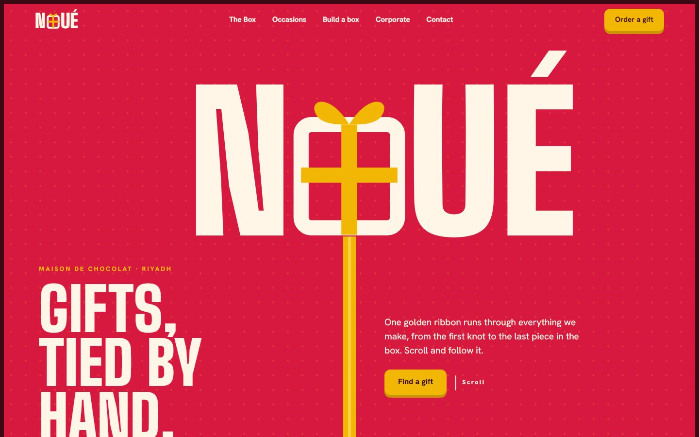

---

## Screenshots

| | |
|---|---|
| 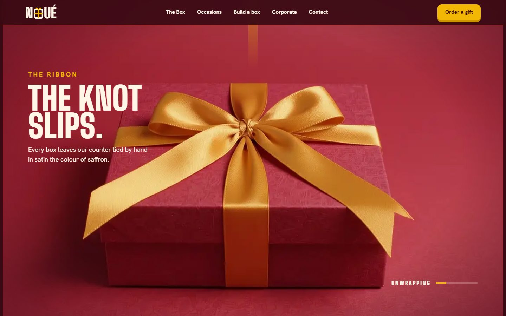 | 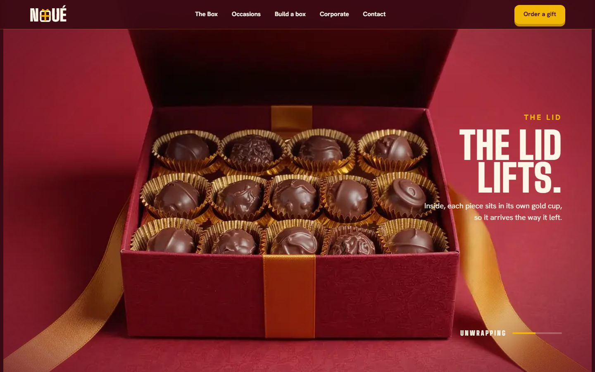 |
| **The ribbon:** the knot slips as you scroll | **The lid:** the box opens, frame by frame |
| 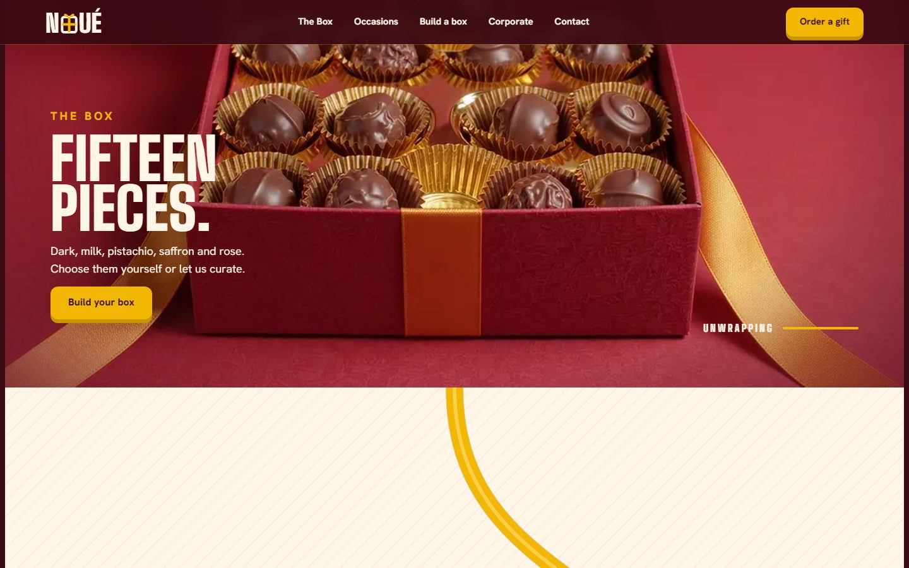 | 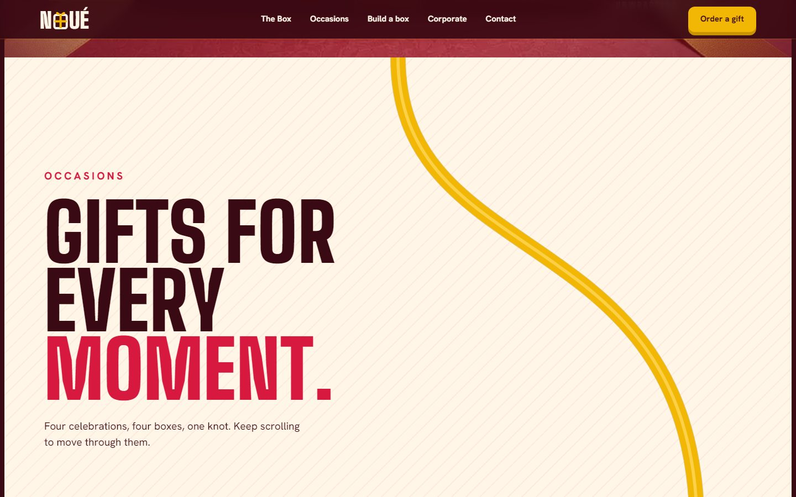 |
| **Fifteen pieces:** dark, milk, pistachio, saffron, rose | **Occasions:** the ribbon leads into four celebrations |
| 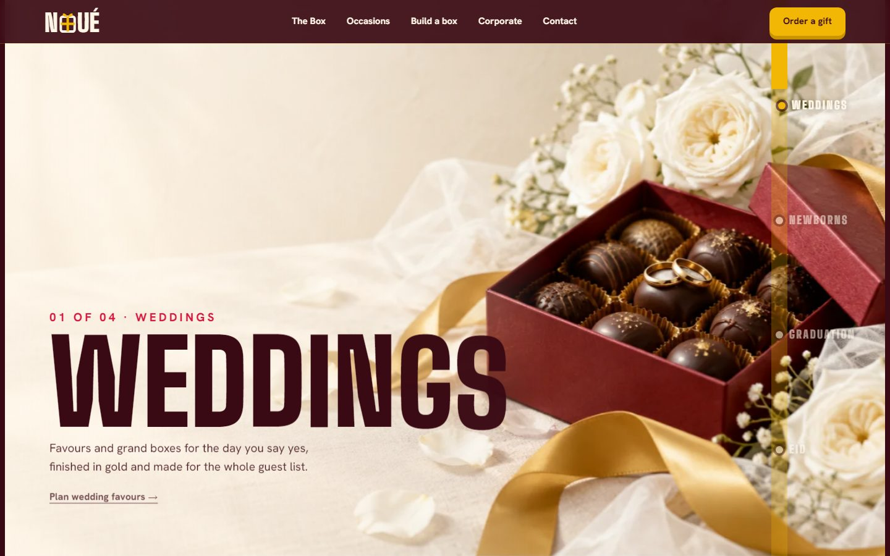 | 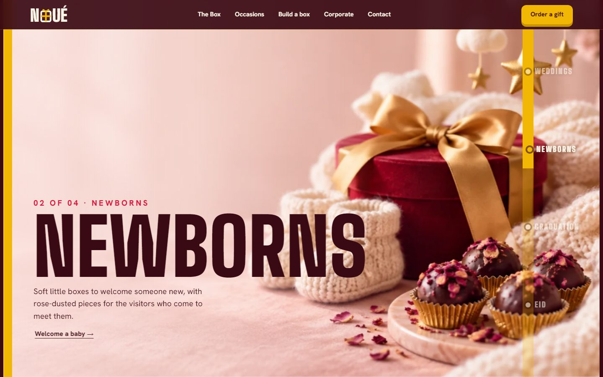 |
| **Weddings:** favours and grand boxes | **Newborns:** soft, rose-dusted boxes |
| 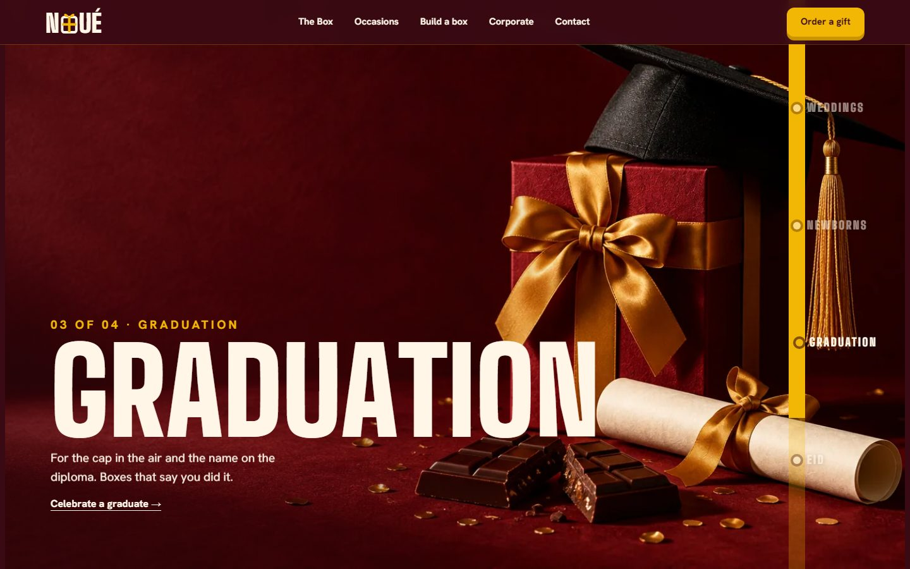 | 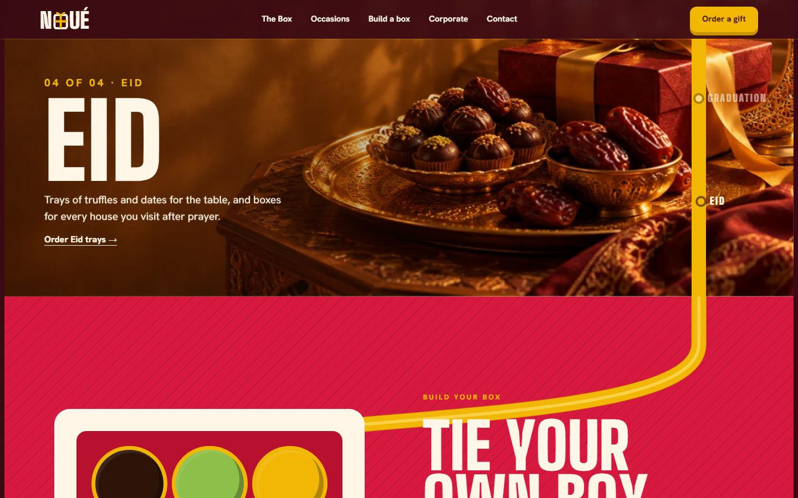 |
| **Graduation:** boxes that say you did it | **Eid:** trays of truffles and dates |
| 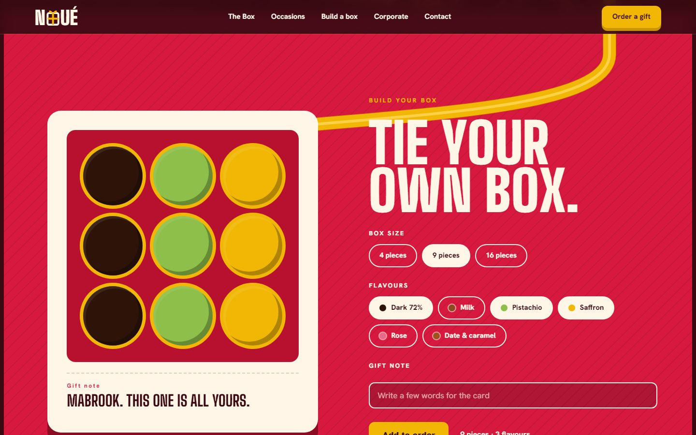 | 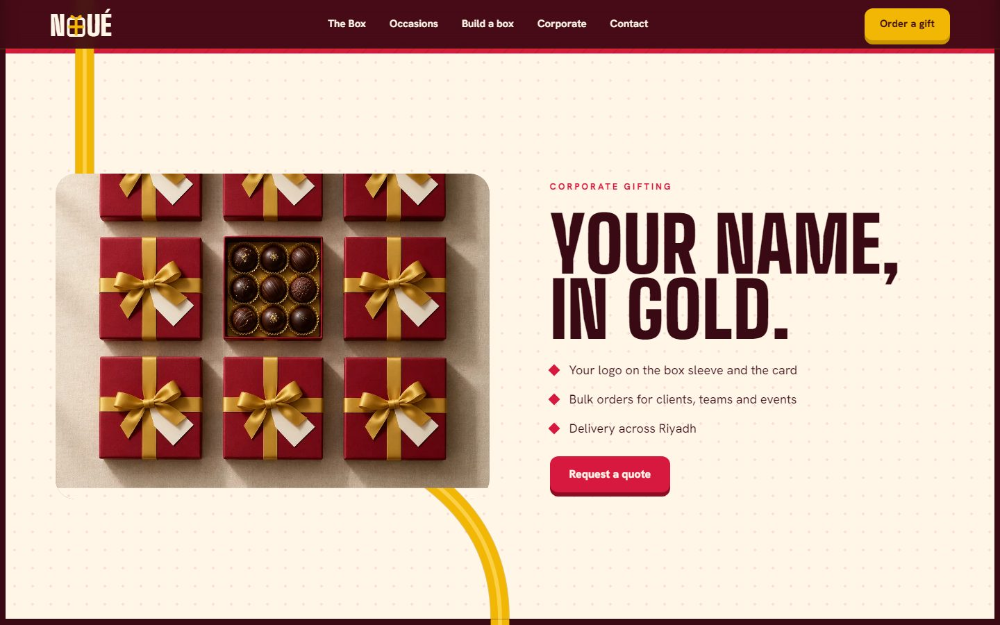 |
| **Tie your own box:** pick a size, flavours and a note | **Corporate:** your name, in gold |

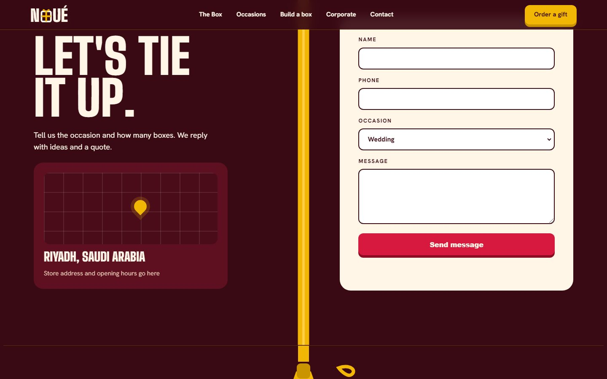

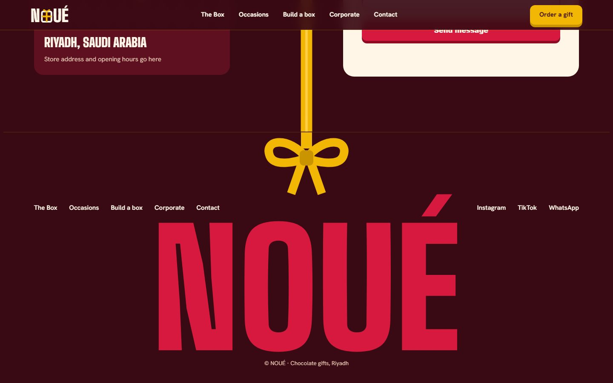

### On a phone

<p align="center">
  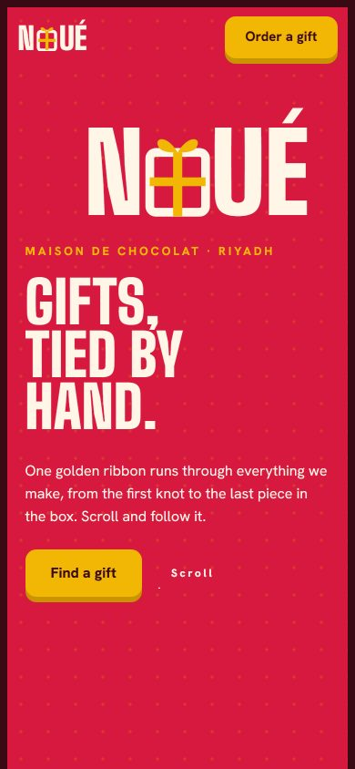
  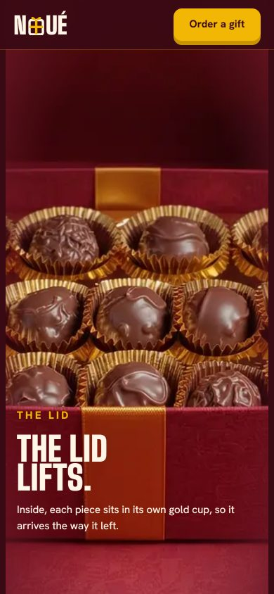
  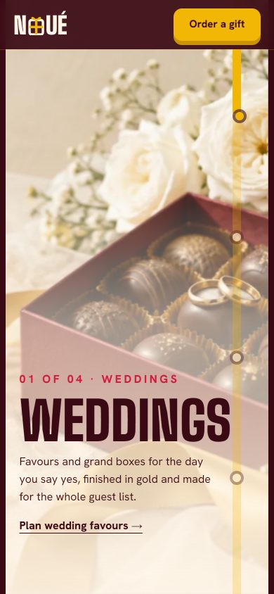
  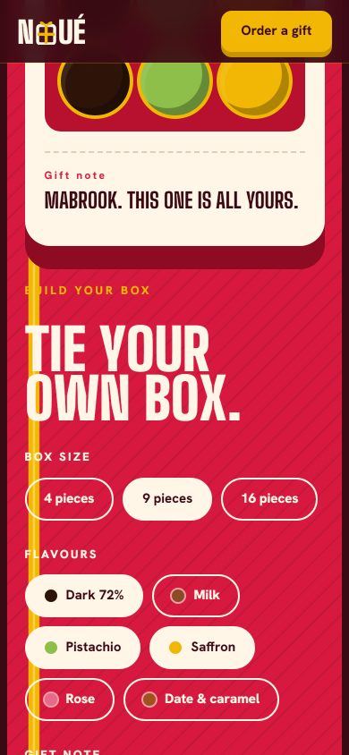
  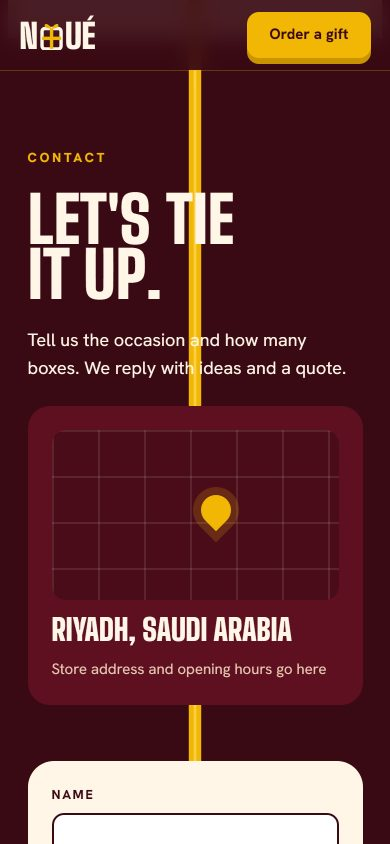
</p>

---

## Tech stack

- **[Next.js 14](https://nextjs.org/)** (App Router, statically prerendered)
- **React 18**
- **[GSAP](https://gsap.com/)** + ScrollTrigger for the pinned scenes and transitions
- **[Lenis](https://lenis.darkroom.engineering/)** for smooth scrolling
- **Big Shoulders Display** and **Hanken Grotesk** fonts (self-hosted via Fontsource)
- Hosted on **[Vercel](https://vercel.com/)**

## Run it locally

```bash
npm install
npm run dev        # http://localhost:3000
npm run build      # production build
npm start          # serve the production build
```

## Project structure

```
app/
  layout.js          fonts, metadata, early "motion" class
  page.js            assembles the sections
  globals.css        all styles and design tokens (:root)
  icon.svg           favicon
components/
  Header.jsx         fixed header + logo
  Hero.jsx           NOUÉ wordmark (the box is the O) + first ribbon segment
  Reveal.jsx         pinned box reveal (94 video frames drawn on a canvas)
  OccasionsIntro.jsx
  Occasions.jsx      4 pinned slides, each with its own transition
  BoxBuilder.jsx     interactive box builder
  Corporate.jsx
  Contact.jsx + ContactForm.jsx
  Footer.jsx         the ribbon ends in a bow
  Thread.jsx         one segment of the gold ribbon
  SplitChars.jsx     splits headings into letters for animation
  ScrollEffects.jsx  all GSAP / Lenis motion
public/
  img/               occasion + corporate images
  frames/            f001–f094.webp, the box video frames
docs/screenshots/    images used in this README
```

## Scenes

Hero (wordmark with the gift box as the O) → The ribbon (the knot slips) → The lid lifts →
Fifteen pieces → Gifts for every moment → Weddings → Newborns → Graduation → Eid →
Tie your own box (interactive builder) → Corporate gifting → Contact → Footer (the ribbon ends in a bow).

## Customise for a real shop

- **Brand name and logo:** `NOUÉ` in `Header`, `Hero`, `Footer` and `app/layout.js`
- **Colours:** tokens at the top of `app/globals.css`
- **Store address and hours:** `components/Contact.jsx`
- **Accessibility:** visitors with "reduce motion" turned on get a static, fully readable version automatically

## Notes

- The contact form shows a thank-you message but doesn't send anything yet. To make it send, wire `handleSubmit` in `components/ContactForm.jsx` to EmailJS, Formspree or an API route.
- Link previews (WhatsApp, X, LinkedIn, iMessage) show `app/opengraph-image.jpg` (1200×630). Replace it and `app/twitter-image.jpg` to change the preview.
- Deployed on Vercel as the project `noue-chocolate`. To redeploy by hand: `vercel deploy --prod`.

---

© 2026 NOUÉ · Chocolate gifts, Riyadh
